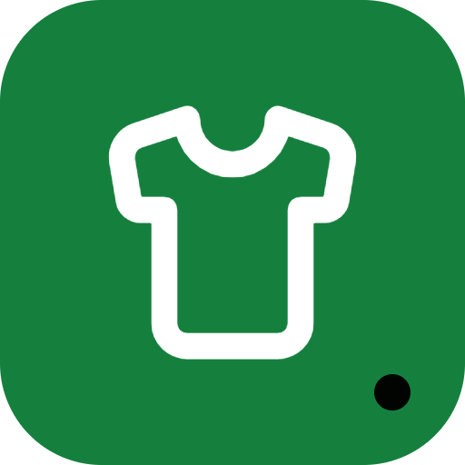
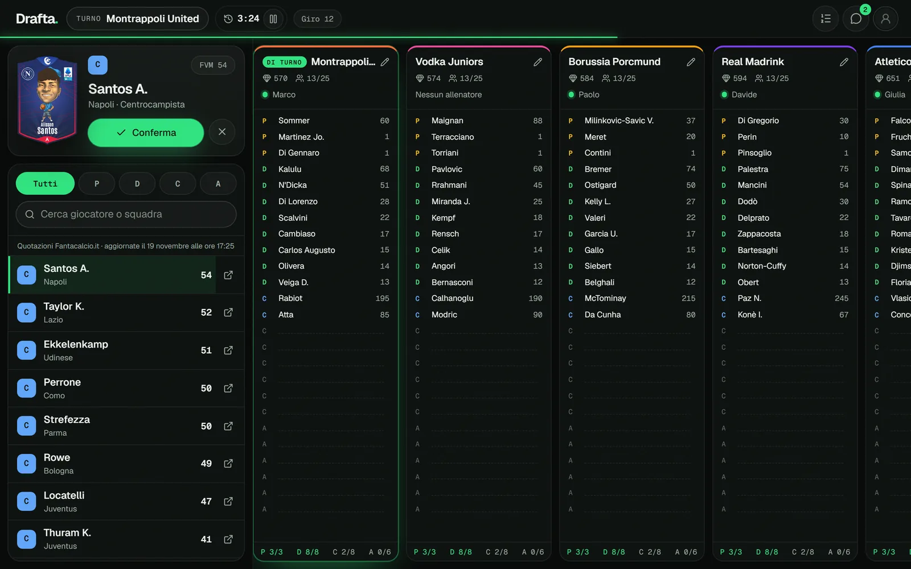
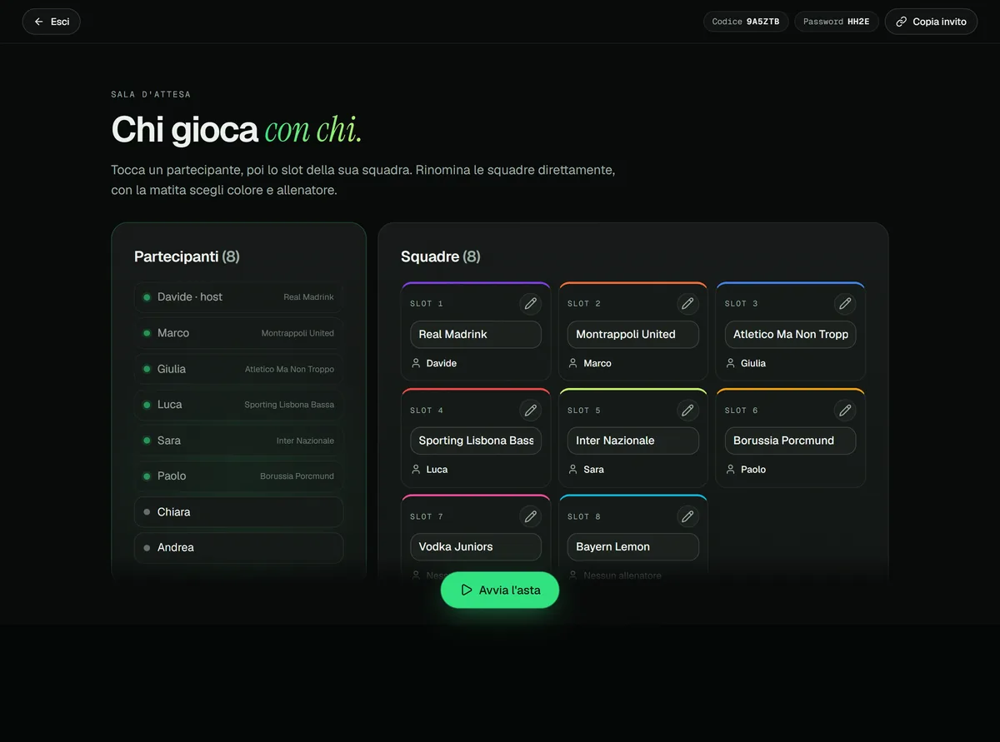
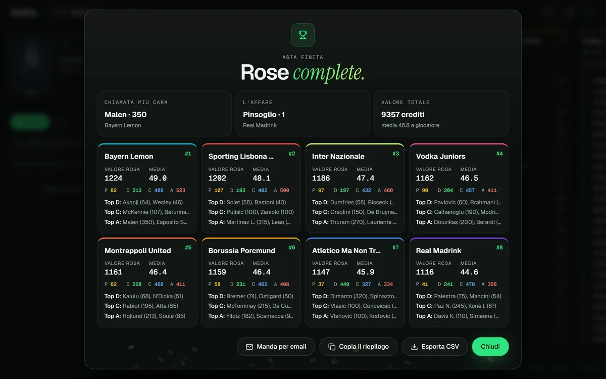

<p align="center">
  
</p>

<h1 align="center">Drafta</h1>

<p align="center">
  Your fantasy football draft, live and in turns: you open a room, your friends join, everyone picks when it's their turn.<br>
  <a href="#english">English</a> · <a href="#italiano">Italiano</a> · <a href="https://davide-mariotti.github.io/apps/drafta">Website</a> · <a href="https://drafta-dm.github.io">Open the app</a>
</p>

<p align="center">
  <a href="https://ko-fi.com/Z0X32ATNHL"></a>
</p>

<p align="center">
  
</p>
<p align="center">
   
</p>

---

## English

### What it does

- Runs a Serie A fantasy football (Fantacalcio) draft for 4 to 20 teams, in the browser, live: every pick shows up on everyone's screen at once.
- The host creates the room and shares a code and a password, or one link that does both. Then assigns each participant to a team, and picks the colours.
- Turns go in order. In the first round the host shuffles; from the second on, whoever spent less picks first.
- Optional rules: the role order (3 goalkeepers, then 8 defenders, 8 midfielders, 6 forwards) and the goalkeeper block (take one keeper, the others of the same club come along).
- A timer per pick, from one minute to four hours. When it runs out, Drafta picks the most expensive free player in the role the team needs. The host can pause it and undo the last pick.
- Notifications when it's your turn, even with Drafta closed, and a nudge for whoever is asleep on it. A chat, the history of every pick, and at the end a summary to copy or send by email.
- Players and prices (FVM) come from Fantacalcio.it and are updated every day. Rosters can be exported to CSV in the Fantacalcio.it league format, and imported to run a repair draft.

### What it doesn't do

- It isn't an auction: nobody bids. Each player costs his FVM, and the order of the turns does the balancing.
- It doesn't run your league: no line-ups, no match days, no scores. It ends when the rosters are full.
- It doesn't speak English: the app is in Italian, like the game it's for.
- It doesn't work offline, and it needs a Google account to sign in.
- It doesn't keep your data for itself: rooms, names, chat and push tokens live in Firebase (Google) and nowhere else. No ads, no analytics.
- On iPhone, notifications only arrive with Drafta added to the Home screen (iOS 16.4 or newer). That's Apple's rule, not mine.

### How to use it

1. Open [drafta-dm.github.io](https://drafta-dm.github.io) and sign in with Google. On a phone, add it to the Home screen: the login page explains how.
2. **Create a draft**: number of teams, time per pick, the two rules. You get a code and a password to send around, or copy the invite link.
3. **Lobby**: tap a participant, then the slot of their team. The pencil changes name, colour and coach. Then **Start the draft**.
4. **Draft**: whoever is on turn taps a name in the list and confirms. The list only shows who can still be picked. The host can pick for anyone, and finds undo, sound and CSV export in the profile menu.
5. **Repair draft**: on the home page, **Import rosters from CSV** creates a room from the rosters you already have, and asks how to decide the turns (missing roles, fewest players, lowest value).

### How it works

1. A static page on GitHub Pages: plain HTML, CSS and JavaScript modules, no build step. Google sign-in through Firebase Authentication.
2. Each room is one Firestore document (teams, rosters, order, turn, history). Every client listens to it, so everyone sees the same thing. Chat and presence (who has Drafta open) live in subcollections, so they don't make everyone download the room again.
3. `firestore.rules` decides who can do what: only the people in a room can read it, joining needs the right password, members can't touch password, host or rules. The draft rules themselves are in `js/draft-rules.js`.
4. A Cloud Function (`functions/index.js`) sends the push when the turn changes or someone nudges you.
5. A GitHub Action downloads the Fantacalcio.it price list every morning (`scripts/`), turns it into `js/data/players.js` and commits it only if something changed.

### Build from source

Serve the folder as it is, for example `npx serve .`, and open http://localhost:3000 (localhost is allowed by Firebase Authentication).

```sh
node test/draft-rules.test.mjs            # turns, picks, goalkeeper block, auto pick
cd test && npm install && npm test        # the same, plus firestore.rules on the Firestore emulator (needs Java 11+)
firebase deploy --only firestore:rules,functions
FANTACALCIO_USERNAME=... FANTACALCIO_PASSWORD=... python scripts/update_players.py
```

### Support

If Drafta saved your draft night from a spreadsheet, you can [buy me a coffee on Ko-fi](https://ko-fi.com/Z0X32ATNHL). That's how the next app gets written.

### License

[MIT](LICENSE). Players, prices and player cards come from Fantacalcio.it and are theirs. Firebase JavaScript SDK (Apache-2.0), Lucide icons (ISC), Geist, Geist Mono and Instrument Serif fonts (SIL Open Font License).

---

## Italiano

### Cosa fa

- Fa il draft del fantacalcio, da 4 a 20 squadre, nel browser e in diretta: ogni scelta compare subito sullo schermo di tutti.
- L'host crea la stanza e manda codice e password, oppure un link che fa tutto. Poi assegna ogni partecipante a una squadra e sceglie i colori.
- I turni vanno in ordine. Al primo giro l'host mescola; dal secondo sceglie prima chi ha speso meno.
- Regole a scelta: l'ordine dei ruoli (3 portieri, poi 8 difensori, 8 centrocampisti, 6 attaccanti) e il blocco portieri (prendi un portiere, arrivano anche gli altri della stessa squadra).
- Un timer per ogni scelta, da un minuto a quattro ore. Allo scadere Drafta assegna il giocatore libero più caro nel ruolo che serve. L'host può metterlo in pausa e annullare l'ultima scelta.
- Una notifica quando tocca a te, anche con Drafta chiusa, e un sollecito per chi si è addormentato. La chat, la cronologia di tutte le scelte, e alla fine un riepilogo da copiare o mandare per email.
- Giocatori e quotazioni (FVM) arrivano da Fantacalcio.it e si aggiornano ogni giorno. Le rose si esportano in CSV nel formato delle leghe di Fantacalcio.it, e si importano per fare l'asta di riparazione.

### Cosa non fa

- Non è un'asta a rilanci: nessuno offre. Ogni giocatore costa la sua FVM, e a bilanciare ci pensa l'ordine dei turni.
- Non gestisce la lega: niente formazioni, giornate, punteggi. Finisce quando le rose sono piene.
- Non parla inglese: l'app è in italiano, come il gioco per cui è fatta.
- Non funziona offline, e per entrare serve un account Google.
- Non si tiene i tuoi dati: stanze, nomi, chat e token delle notifiche stanno su Firebase (Google) e da nessun'altra parte. Niente pubblicità, niente statistiche.
- Su iPhone le notifiche arrivano solo con Drafta aggiunta alla schermata Home (iOS 16.4 o successivo). La regola è di Apple, non mia.

### Come si usa

1. Apri [drafta-dm.github.io](https://drafta-dm.github.io) e accedi con Google. Sul telefono aggiungila alla Home: la pagina d'accesso spiega come.
2. **Crea un'asta**: numero di squadre, tempo per ogni scelta, le due regole. Ottieni codice e password da girare, o copi il link d'invito.
3. **Sala d'attesa**: tocca un partecipante, poi lo slot della sua squadra. La matita cambia nome, colore e allenatore. Poi **Avvia l'asta**.
4. **Draft**: chi è di turno tocca un nome nella lista e conferma. La lista mostra solo chi si può ancora prendere. L'host può scegliere al posto di chiunque, e nel menu del profilo trova annulla, suoni ed esportazione CSV.
5. **Asta di riparazione**: dalla home, **Importa rose da CSV** crea una stanza con le rose che hai già, e chiede come decidere i turni (ruolo mancante, meno giocatori, valore più basso).

### Come funziona

1. Una pagina statica su GitHub Pages: HTML, CSS e moduli JavaScript, niente build. L'accesso con Google passa da Firebase Authentication.
2. Ogni stanza è un documento Firestore (squadre, rose, ordine, turno, cronologia). Tutti i client lo ascoltano, così tutti vedono la stessa cosa. Chat e presenza (chi ha Drafta aperta) stanno in sottocollezioni, così non costringono tutti a riscaricare la stanza.
3. `firestore.rules` decide chi può fare cosa: la stanza la legge solo chi ci è dentro, per entrare serve la password giusta, i partecipanti non toccano password, host e regole. Le regole del draft sono in `js/draft-rules.js`.
4. Una Cloud Function (`functions/index.js`) manda la notifica quando cambia il turno o quando qualcuno ti sollecita.
5. Una GitHub Action ogni mattina scarica il listone di Fantacalcio.it (`scripts/`), lo trasforma in `js/data/players.js` e fa il commit solo se è cambiato qualcosa.

### Compilarlo

Basta servire la cartella così com'è, per esempio con `npx serve .`, e aprire http://localhost:3000 (localhost è già autorizzato in Firebase Authentication).

```sh
node test/draft-rules.test.mjs            # turni, scelte, blocco portieri, scelta d'ufficio
cd test && npm install && npm test        # lo stesso, più firestore.rules sull'emulatore Firestore (serve Java 11+)
firebase deploy --only firestore:rules,functions
FANTACALCIO_USERNAME=... FANTACALCIO_PASSWORD=... python scripts/update_players.py
```

### Supporto

Se Drafta ha salvato la serata dell'asta da un foglio Excel, puoi [offrirmi un caffè su Ko-fi](https://ko-fi.com/Z0X32ATNHL). È così che nasce la prossima app.

### Licenza

[MIT](LICENSE). Giocatori, quotazioni e figurine arrivano da Fantacalcio.it e sono loro. Firebase JavaScript SDK (Apache-2.0), icone Lucide (ISC), font Geist, Geist Mono e Instrument Serif (SIL Open Font License).
